<p align="center">
  <picture>
    <source media="(prefers-color-scheme: dark)" srcset="docs/images/hero-dark.webp">
    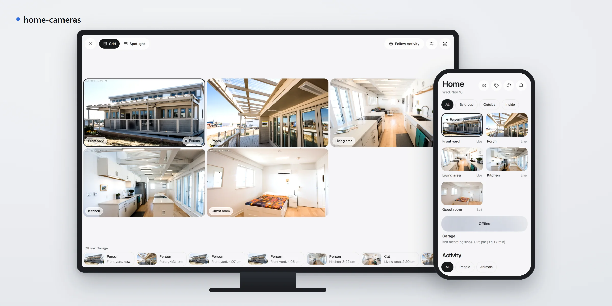
  </picture>
</p>

# home-cameras

A recorder for home cameras that runs on one computer in your home, with an app for your phone and your desktop.

<p>
  
  
  
</p>

## Screenshots

The screenshots show demo cameras made from public-domain photos. They do not show a real install.

<table>
  <tr>
    <td valign="top">
      <picture>
        <source media="(prefers-color-scheme: dark)" srcset="docs/images/desktop-home-dark.webp">
        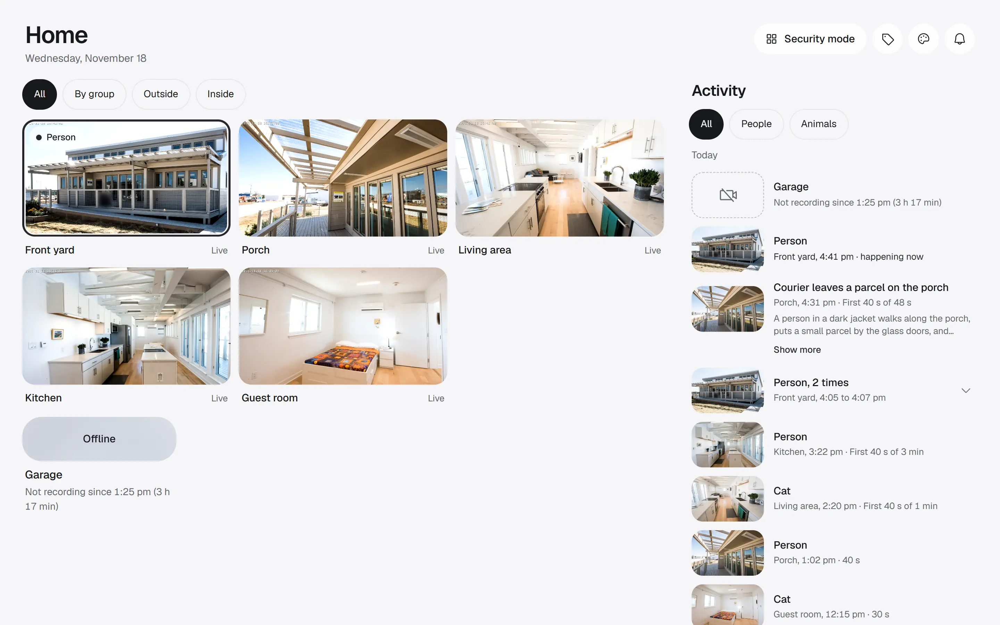
      </picture>
      <br><sub>Home: live cameras and one list of what they saw.</sub>
    </td>
    <td valign="top">
      <picture>
        <source media="(prefers-color-scheme: dark)" srcset="docs/images/desktop-wall-dark.webp">
        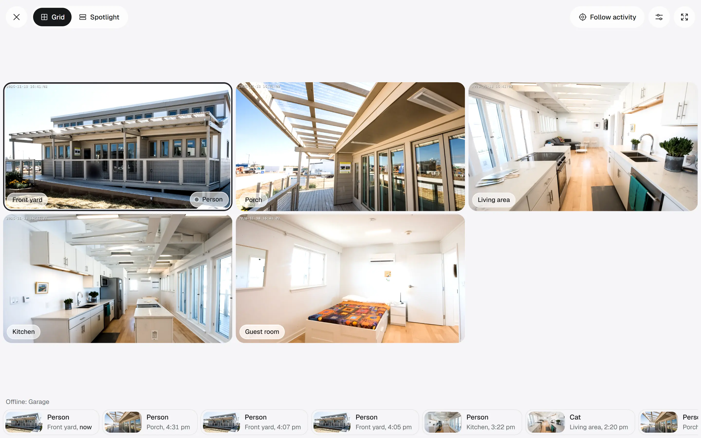
      </picture>
      <br><sub>Security mode: every camera on one screen.</sub>
    </td>
  </tr>
  <tr>
    <td valign="top">
      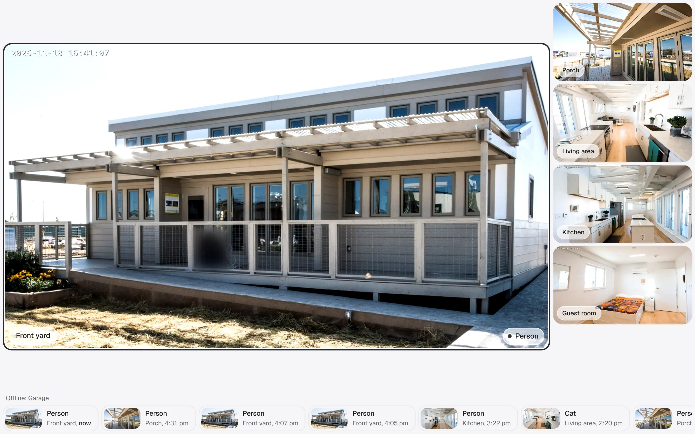
      <br><sub>The spotlight layout shows one camera large.</sub>
    </td>
    <td valign="top">
      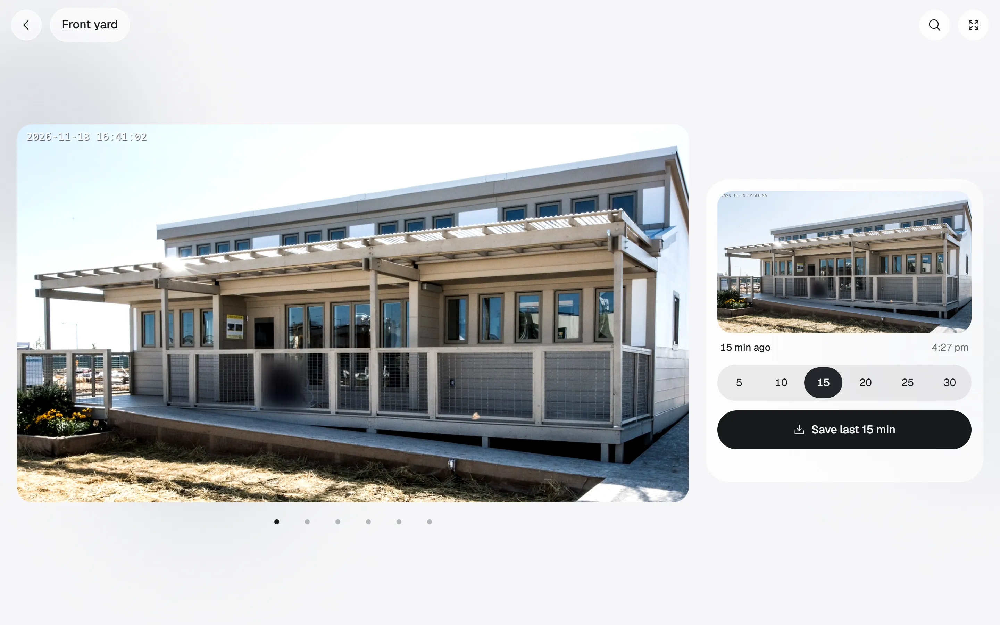
      <br><sub>Camera view: go back in the recording and save a clip.</sub>
    </td>
  </tr>
</table>

<p align="center">
  <picture>
    <source media="(prefers-color-scheme: dark)" srcset="docs/images/desktop-groups-dark.webp">
    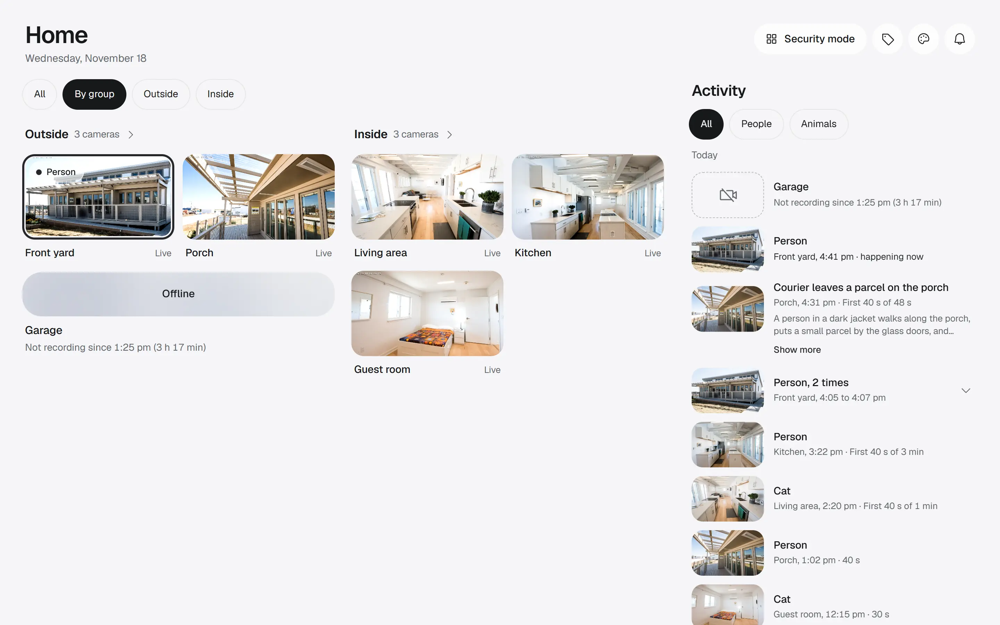
  </picture>
  <br><sub>Groups: give the cameras your own names, and see the groups next to each other.</sub>
</p>

<table>
  <tr>
    <td valign="top">
      <picture>
        <source media="(prefers-color-scheme: dark)" srcset="docs/images/phone-home-dark.webp">
        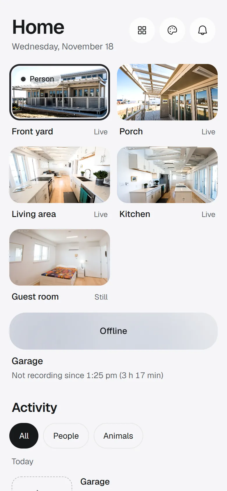
      </picture>
      <br><sub>Home on a phone.</sub>
    </td>
    <td valign="top">
      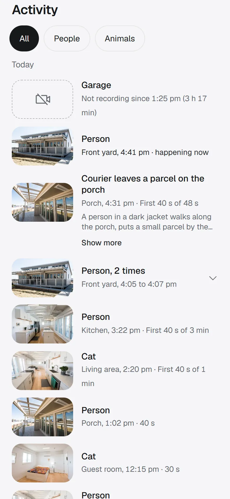
      <br><sub>Activity: people, animals, vehicles and sounds.</sub>
    </td>
    <td valign="top">
      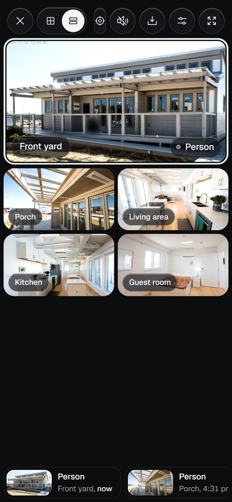
      <br><sub>Security mode on a phone.</sub>
    </td>
    <td valign="top">
      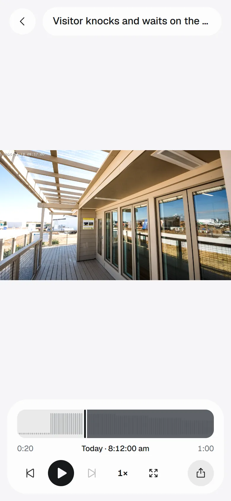
      <br><sub>The clip player with its timeline.</sub>
    </td>
  </tr>
</table>

<p align="center">
  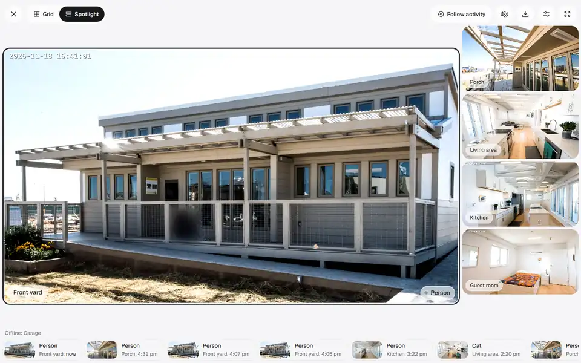
</p>

## What it does

- It records every camera all day and keeps the recordings for a set number of days.
- It finds people, dogs, and cats, and cuts a clip of each event.
- It shows live view, clips, and a timeline in an app for your phone and your desktop.
- It sends phone alerts for a dog that barks, a smoke alarm, and breaking glass.
- You see the app away from home through Tailscale. The recorder sends no camera picture to a public server. A Wyze camera still talks to Wyze through the bridge.

The app runs in a browser, on a phone and on a desktop. On an iPhone, add it to the Home Screen and it opens like an app.

| Feature | What it does |
|---------|--------------|
| Home | Each camera plays live. With many cameras the app shows a grid, and only some tiles play video at one time. The others show a still that refreshes. A camera that is offline shows since when. |
| Names and groups | Give each camera your own name, and put cameras into groups such as "Outside" and "Inside". Home can show all cameras, one group, or all groups next to each other. Security mode can show one group. The names and groups are the same on every device; each device keeps its own view. |
| Activity | One list of what the cameras saw: people, animals, vehicles, and sounds. Events that are close together fold into one row. Tap a row to play its clip. |
| Camera view | Live video with pinch to zoom, a dial to go back in the recording, and a button to save the last minutes as a clip. |
| Security mode | A wall of all cameras with no other content. A camera gets a mark while the recorder sees a person, an animal, or a vehicle there. A spotlight layout shows one camera large. "Follow activity" moves the spotlight to the camera with the newest detection. The screen stays on. You can hide a camera, change the order, and save a still. |
| Phone alerts | For a smoke alarm or breaking glass, and for a dog that barks while no person is home. They need the Tailscale address (see `INSTALL.md`). |
| A clean live stream | Some cameras send damaged video frames over Wi-Fi, and a browser then drops the picture. The recorder can encode the video again, which hides the damage. The app uses this stream when it shows one or two cameras. |
| Themes | Light and dark, in several colours. |
| Optional | Short text summaries of events from a vision model on your own computer (Ollama), and a "day of your pet" page for one camera. Both are off until you set them up. |

## Install it with your AI assistant

Use an AI assistant that can run commands in a terminal on the computer that will run the recorder, for example Claude Code, OpenAI Codex, or Gemini CLI. Send it these three lines:

```text
Install this for me: <the link to this repository>
Follow INSTALL.md in the repository, step by step.
Tell me when a step needs me. Do not ask me for a password or a key in the chat.
```

The assistant runs the commands. It tells you when a step is yours, for example when you type a password into a file.

You can also follow `INSTALL.md` by hand. The repository holds `AGENTS.md` with the rules for an assistant.

## What you need

- A computer that stays on, with at least 8 GB of memory and room for recordings (see "Disk space" in `INSTALL.md`).
  It can run macOS (Apple silicon or Intel), Windows 10 or 11, or Linux.
- Docker. On macOS and Windows this is Docker Desktop. On Linux this is Docker Engine with the Compose plugin.
- Cameras: Wyze cameras, or any camera that gives an RTSP stream.
- A free Tailscale account, to see the app away from home.
- A phone. Alerts on an iPhone need iOS 16.4 or later.

## How it works

<p align="center">
  <picture>
    <source media="(prefers-color-scheme: dark)" srcset="docs/images/architecture-dark.svg">
    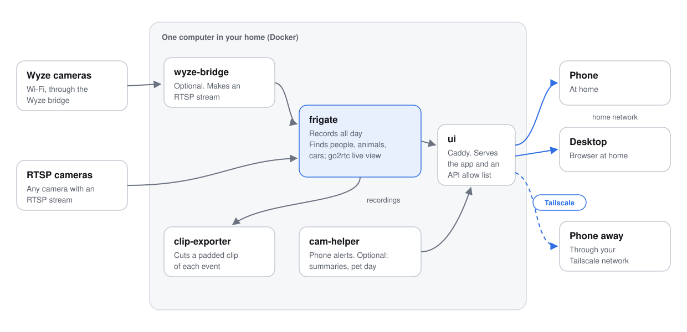
  </picture>
</p>

Docker runs each part as a container on one computer.

| Part | What it does |
|------|--------------|
| `frigate` | Reads each camera, records, finds objects, and gives live view. |
| `go2rtc` | Lives inside the Frigate image. It shares one camera connection between recording and live view. |
| `wyze-bridge` | Optional. It turns a Wyze camera into an RTSP stream. It runs only for Wyze cameras. |
| `clip-exporter` | Cuts a padded clip of each event from the recordings. |
| `cam-helper` | Sends the phone alerts. Optional: summaries and the pet day. |
| `ui` | Caddy web server. It serves the app and passes only the Frigate paths that the app needs. |
| `setup` | A tool that you run on demand. Commands: `init`, `sync`, `remove`, `doctor`. |

## Update

Run these commands in the project folder:

```text
git pull
docker compose build
docker compose run --rm setup sync
docker compose up -d
docker compose run --rm setup doctor --wait 180
```

`.env`, `cameras.yml`, and `frigate/config/config.yml` stay as they are.
A new setting in `.env.example` does not appear in your `.env` by itself.
Read `.env.example` after an update and add each new setting you want.

## Stop and remove

- Stop the recorder and keep the recordings: `docker compose stop`
- Start it again: `docker compose up -d`
- Remove the containers: `docker compose down`
- Remove the containers and the Frigate database volume: `docker compose down --volumes`
- Recordings and clips are in the folder `MEDIA_DIR` of your `.env` (default `./media`).
  Docker never deletes this folder. Delete it yourself when you want the disk space back.
- To stop the Tailscale link: `tailscale serve reset`

## Development

All the Python tests (helper, exporter, setup) run in Docker, with no Python on the host:

```text
docker compose run --rm test
```

The app (`ui/app`) needs Node.js on the host:

```text
cd ui/app
npm ci
npm test
npx tsc -b
npm run build
```

## Documents

| Document | For |
|----------|-----|
| `INSTALL.md` | The install, step by step, for a person or an AI assistant. |
| `docs/TROUBLESHOOTING.md` | Faults and how to fix them. |
| `CONTRIBUTING.md` | How to change the code and send a change. |
| `SECURITY.md` | How to report a security problem. |

## Credits

### Demo photos

The screenshots show demo photos, not a real install. The camera names, the events and the summaries are invented.

All five photos show one house: the Team Alabama "surviv(AL)" house at the U.S. Department of Energy Solar Decathlon 2017 in Denver. The U.S. Department of Energy Solar Decathlon published them with the Public Domain Mark. Wikimedia Commons holds a copy of each photo and lists it as a public-domain work of the U.S. Department of Energy.

Credit: Dennis Schroeder/U.S. Department of Energy Solar Decathlon.

| Camera in the demo | Photo on Wikimedia Commons | Licence |
|--------------------|----------------------------|---------|
| Front yard | [SD2017 Gallery of Houses (37482565841)](https://commons.wikimedia.org/wiki/File:SD2017_Gallery_of_Houses_(37482565841).jpg) | Public domain |
| Porch | [SD2017 Gallery of Houses (37482564721)](https://commons.wikimedia.org/wiki/File:SD2017_Gallery_of_Houses_(37482564721).jpg) | Public domain |
| Living area | [SD2017 Gallery of Houses (37224859710)](https://commons.wikimedia.org/wiki/File:SD2017_Gallery_of_Houses_(37224859710).jpg) | Public domain |
| Kitchen | [SD17Gallery of Houses (37224863890)](https://commons.wikimedia.org/wiki/File:SD17Gallery_of_Houses_(37224863890).jpg) | Public domain |
| Guest room | [SD17Gallery of Houses (37482563301)](https://commons.wikimedia.org/wiki/File:SD17Gallery_of_Houses_(37482563301).jpg) | Public domain |

The demo changes each photo: it crops the photo to 16:9, moves the view slowly, and adds a time stamp. In the front yard photo, a blur hides a person on the porch. The offline Garage camera has no photo.

The U.S. Department of Energy does not endorse this project. A brand name that a photo shows is incidental, and this project has no connection with that brand.

### Third-party software

The recorder runs the software below. It is not part of this repository, except where the table says so.

| Software | How this project uses it | Licence |
|----------|--------------------------|---------|
| Frigate (ghcr.io/blakeblackshear/frigate) | Container image, not changed | MIT, Copyright (c) 2026 Frigate, Inc. |
| go2rtc (inside the Frigate image) | Restream of each camera | MIT, Copyright (c) 2022 Alexey Khit |
| go2rtc `video-rtc.js` | Copied into `ui/app/src/vendor/video-rtc.js`, with its header kept | MIT, Copyright (c) 2022 Alexey Khit |
| Wyze bridge (idisposablegithub365/wyze-bridge, a fork of docker-wyze-bridge) | Container image, not changed. Optional. | GNU AGPL v3 |
| Caddy (caddy:2-alpine) | Web server in the `ui` image | Apache License 2.0 |
| React, React DOM, Motion, Phosphor Icons, Tailwind CSS | Built into the app | MIT |
| hls.js | Built into the app | Apache License 2.0 |
| Geist font (`@fontsource-variable/geist`) | Built into the app | SIL Open Font License 1.1 |

The Python tools use pywebpush, opencv-python-headless, numpy, ruamel.yaml, and cryptography.
Each has its own licence. See `helper/requirements.txt` and `setup/requirements.txt`.
The npm licence fields come from `ui/app/package-lock.json`.
The licence of each other package is the one in its own release.

## Licence

This project uses the MIT licence. See `LICENSE`. Copyright the home-cameras authors, 2026.

## Notice

This project has no link to Wyze, Frigate, or Tailscale. It is not made, approved, or supported by them.
It only uses their software and services.
